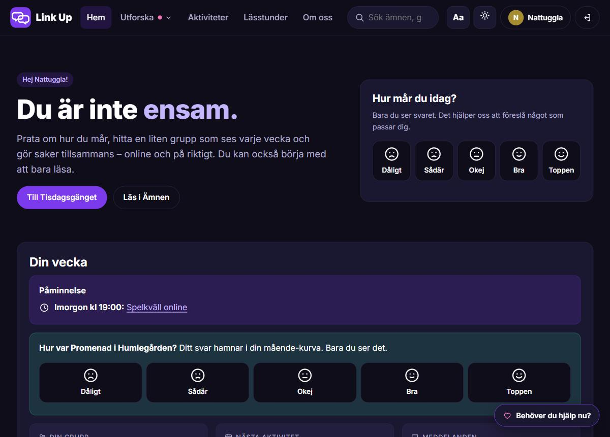
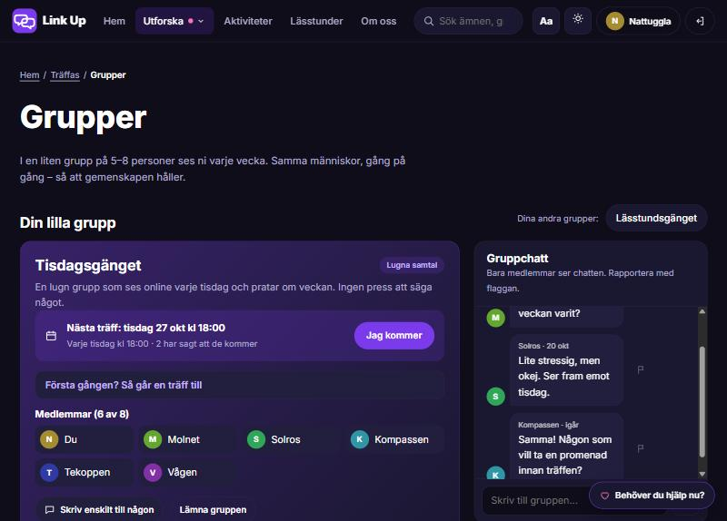
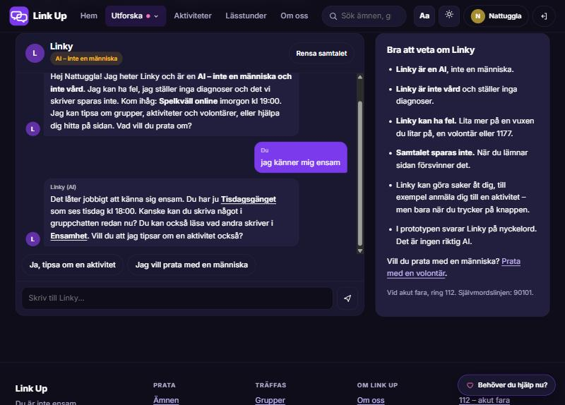
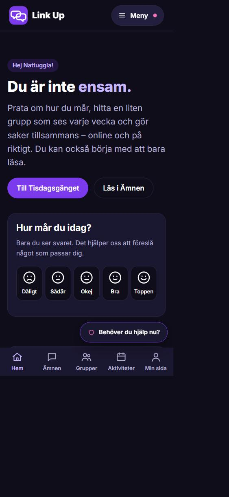

# Link Up – Du är inte ensam.

Link Up är en klickbar prototyp av en trygg digital mötesplats för unga från 15 år. Det som gör Link Up unikt är **gemenskap som håller över tid**: en liten grupp på 5–8 personer som ses varje vecka, och aktiviteter där man faktiskt träffas – inte bara korta stödsamtal.

Link Up är **inte vård** och ställer aldrig diagnoser. Vid akut fara: ring 112. Råd om vård: 1177. Minds Självmordslinjen: 90101.

Ett skolprojekt i kursen Digitalt skapande på Hitachigymnasiet, gjort av Leon, Reda, Sabri och Mikael.

> **Allt är påhittat.** BankID-inloggningen, AI-stödet Linky, volontärerna och all data är påhittade. Inget kopplas till riktiga BankID, ingen riktig AI används och ingenting skickas till någon server. All data sparas bara i din egen webbläsare (localStorage).

## Så ser det ut

| Startsidan | Din lilla grupp |
|---|---|
|  |  |

| Linky | Mobil |
|---|---|
|  |  |

## Öppna sidan

### Lokalt
1. Ladda ner eller klona repot.
2. Dubbelklicka på `index.html` så öppnas sidan i webbläsaren. Ingen server eller installation behövs.

### Via GitHub Pages
1. Gå till repot på GitHub → **Settings** → **Pages**.
2. Välj **Deploy from a branch**, branch **main** och mappen **/ (root)**. Spara.
3. Efter någon minut finns sidan på `https://<ditt-användarnamn>.github.io/<repots-namn>/`.

## Testanvändare

På sidan **Logga in** väljer du vem du vill logga in som. Efter "Öppna BankID-appen" loggas du in automatiskt efter 2 sekunder.

| Testperson | Vad som händer |
|---|---|
| **Vanlig användare** – Nattuggla, 17 år | Loggas in direkt. Har en liten grupp (Tisdagsgänget), samtal och mående-historik. |
| **Ny användare** – 16 år | Hamnar på Första besöket: välj alias, minst tre intressen och godkänn reglerna. |
| **Under 15 år** – 13 år | Nekas med ett vänligt meddelande och tips om Bris på 116 111. |
| **Moderator** – Moderator Kim | Får tillgång till Moderator-sidan. |
| **Avstängd användare** – Stormen | Nekas. Kan inte heller skapa ett nytt konto eftersom inloggningen sker med BankID. |

Vill du börja om? Klicka **Återställ exempeldata** på Min sida.

## Sidor

| Sida | Fil | Innehåll |
|---|---|---|
| Startsida | `index.html` | "Du är inte ensam.", mående-check, tre startkort, populära ämnen, kommande aktiviteter, veckans lässtund och hjälpruta |
| Logga in | `logga-in.html` | Fejkad BankID-inloggning med testpersoner |
| Första besöket | `forsta-besoket.html` | Alias, intressen och regler |
| Utforska | `utforska.html` | Översikt över allt på Link Up |
| Ämnen | `amnen.html` | Inlägg och svar, stödreaktioner utan siffror, rapportera och blockera |
| Grupper | `grupper.html` | Din lilla grupp (medlemmar, nästa träff, Jag kommer, gruppchatt) och sök fler grupper |
| Aktiviteter | `aktiviteter.html` | Filter, Jag vill vara med, Trygg första träff och skapa aktivitet |
| Lässtund | `lasstund.html` | Veckans bok, simulerad uppläsning, Läs själv i takt, Jag vill läsa högt och chatt |
| Samtal | `samtal.html` | Mina samtal och Prata med en volontär |
| Linky | `linky.html` | Regelbaserad AI-chatt som förstår stavfel och följdfrågor, föreslår grupper, aktiviteter och volontärer, kan anmäla dig med en knapp och hjälper dig hitta på sidan |
| Min sida | `min-sida.html` | Alias, mående-kurva, intressen, grupper, aktiviteter, blockeringar och inställningar |
| Moderator | `moderator.html` | Rapporterade och oroande inlägg, Ta bort / Varna / Stäng av / Inget fel |
| Om oss | `om-oss.html` | Vilka vi är och vad vi står för |
| Regler | `regler.html` | Hur vi behandlar varandra |
| Sök | `sok.html` | Sökresultat från sökfältet i menyn |

## Hitta rätt

- Hela sidan är uppdelad i tre delar: **Prata** (Ämnen, Samtal, Linky), **Träffas** (Grupper, Aktiviteter, Lässtunder) och **Om Link Up** (Om oss, Regler).
- På dator öppnar **Utforska** en meny med alla delar. På mobil finns knappen **Meny** högst upp och bottenmenyn längst ner.
- Överst på varje sida står var du är, t.ex. *Hem / Träffas / Grupper*.
- **Din vecka** på startsidan visar din grupp, nästa aktivitet, olästa meddelanden och påminnelser.

## Trygghet och moderering

- **Ordfilter** stoppar svordomar och kränkande ord i inlägg, svar och alla chattar – även omstavningar som "n1gg3r" eller "f u c k" – och visar en vänlig påminnelse om reglerna.
- **Oroande ord** (t.ex. "vill inte leva", "ta mitt liv") öppnar hjälprutan direkt. Inlägg och chattmeddelanden med oroande ord hamnar först på moderatorsidan.
- **Rapportera** inlägg med knappen och chattmeddelanden med flaggan. Det som har 3 eller fler rapporter döljs tills en moderator har tittat på det.
- **Åldersgrupper:** grupper och enskilda samtal är uppdelade i 15–17 år och 18+. Vuxna man kan skriva enskilt med är bara volontärer och kurator.
- **Hjälprutan** visar 112, 1177 och 90101 och har knappen *Vill du att en volontär hör av sig?*.
- **Mående-check:** väljer man Dåligt eller Sådär föreslås lugna grupper, en volontär och stödlinjer.

## Gemenskap som håller

- **Gruppförslag:** efter första besöket föreslås en liten grupp som passar dina intressen och din ålder.
- **Första gången?** Varje grupp och varje Trygg första träff har en guide om hur träffen går till.
- **Påminnelser** om träffar och aktiviteter idag och imorgon.
- **Hur var det?** Efter en aktivitet får du svara hur det var. Svaret hamnar i din mående-kurva.

## Tillgänglighet

- Ljust läge och större text (knapparna **Aa** och sol/måne i menyn, eller på Min sida). Valen sparas.
- Tydlig fokusmarkering för tangentbord, "Hoppa till innehållet"-länk, riktiga knappar och länkar.
- Alla knappar är minst 44 px höga. Ikonerna är egna SVG:er, inga emojis.
- På mobil blir menyn en rad med ikoner längst ner: Hem, Ämnen, Grupper, Aktiviteter, Min sida.

## Teknik och mappar

Vanlig HTML, CSS och JavaScript – inga ramverk, inga npm-paket, ingen server och inga API:er. Typsnittet Inter hämtas från Google Fonts (utan internet används systemets typsnitt).

```
index.html, logga-in.html, ...   sidorna
css/style.css                    all design
js/data.js                       databasen: tabeller, exempeldata och hjälpfunktioner
js/app.js                        gemensamt: meny, inloggning, ordfilter, hjälpruta, tema
js/<sida>.js                     kod för varje sida
img/logo.svg, img/favicon.svg    logga
docs/databas.md                  beskrivning av databasen
```

Läs mer om tabellerna och se ER-diagrammet i [docs/databas.md](docs/databas.md).

## Från prototyp till riktig tjänst

Det här skulle en riktig version av Link Up behöva:

- **En server och en riktig databas** i stället för localStorage, så att data delas mellan användare och sparas säkert.
- **Riktig BankID-inloggning** via en godkänd leverantör.
- **GDPR:** mående och samtal om psykisk hälsa är känsliga personuppgifter (hälsodata). De måste krypteras, bara sparas så länge de behövs, och användaren måste kunna se och ta bort sin data.
- **Utbildade moderatorer och volontärer** med bakgrundskontroll, och en tydlig rutin för vad man gör när någon är i fara.
- **Samarbete** med till exempel Mind, Bris och skolornas elevhälsa.
- **Användartester** med unga i målgruppen innan lansering.
