# Databas – Link Up

All data i prototypen är påhittad. Den ligger i `js/data.js` som **normaliserade tabeller** (en array per tabell) och sparas i webbläsarens `localStorage` under nyckeln `linkup_db_v1`. Knappen **Återställ exempeldata** på Min sida laddar om exempeldatan.

## Regler vi följer

- Tabellnamn i plural, fältnamn på engelska med små bokstäver.
- Ingen uppgift sparas på två ställen. Andra tabeller pekar på en rad med dess `id`.
- Inga listor i fält. Varje N:M-relation har en egen kopplingstabell.
- Inget sparas som kan räknas fram. Det sköts av hjälpfunktioner i `js/data.js`.

## ER-diagram

GitHub ritar diagrammet automatiskt. `||--o{` betyder "en till många", `|o--o{` betyder "noll eller en till många" (fältet får vara tomt).

```mermaid
erDiagram
    users {
        int id PK
        string bankid_hash UK
        string alias UK
        date birth_date
        string role
        datetime created_at
    }
    interests {
        int id PK
        string name UK
    }
    user_interests {
        int user_id PK, FK
        int interest_id PK, FK
    }
    topics {
        int id PK
        string name UK
    }
    posts {
        int id PK
        int user_id FK
        int topic_id FK
        string body
        datetime created_at
        datetime removed_at
    }
    replies {
        int id PK
        int post_id FK
        int user_id FK
        string body
        datetime created_at
    }
    support_reactions {
        int user_id PK, FK
        int post_id PK, FK
        string type PK
        datetime created_at
    }
    groups {
        int id PK
        string name UK
        string description
        int interest_id FK
        int max_members
        datetime created_at
    }
    group_members {
        int group_id PK, FK
        int user_id PK, FK
        datetime joined_at
    }
    group_messages {
        int id PK
        int group_id FK
        int user_id FK
        string body
        datetime created_at
    }
    group_attendance {
        int group_id PK, FK
        int user_id PK, FK
        date meeting_date PK
    }
    direct_messages {
        int id PK
        int sender_id FK
        int receiver_id FK
        string body
        datetime created_at
        datetime read_at
    }
    books {
        int id PK
        string title
        string author
    }
    activities {
        int id PK
        int created_by FK
        string title
        string description
        string location
        datetime starts_at
        int max_participants
        boolean is_safe_first_meet
        int book_id FK
        datetime created_at
    }
    activity_participants {
        int activity_id PK, FK
        int user_id PK, FK
        datetime joined_at
    }
    mood_checks {
        int id PK
        int user_id FK
        int mood
        datetime created_at
    }
    reports {
        int id PK
        int reporter_id FK, UK
        int post_id FK, UK
        string reason
        datetime created_at
    }
    blocks {
        int blocker_id PK, FK
        int blocked_id PK, FK
        datetime created_at
    }
    moderation_actions {
        int id PK
        int moderator_id FK
        int user_id FK
        string action
        int post_id FK
        string reason
        datetime created_at
    }
    volunteer_hours {
        int user_id FK
        int weekday
        int start_hour
        int end_hour
    }

    users ||--o{ user_interests : "väljer"
    interests ||--o{ user_interests : "väljs av"
    users ||--o{ posts : "skriver"
    topics ||--o{ posts : "samlar"
    posts ||--o{ replies : "får"
    users ||--o{ replies : "skriver"
    users ||--o{ support_reactions : "ger"
    posts ||--o{ support_reactions : "får"
    interests ||--o{ groups : "tema för"
    groups ||--o{ group_members : "har"
    users ||--o{ group_members : "är med i"
    groups ||--o{ group_messages : "har"
    users ||--o{ group_messages : "skriver"
    groups ||--o{ group_attendance : "har träffar"
    users ||--o{ group_attendance : "kommer till"
    users ||--o{ direct_messages : "skickar"
    users ||--o{ direct_messages : "tar emot"
    users ||--o{ activities : "skapar"
    books |o--o{ activities : "läses på"
    activities ||--o{ activity_participants : "har"
    users ||--o{ activity_participants : "deltar i"
    users ||--o{ mood_checks : "gör"
    users ||--o{ reports : "rapporterar"
    posts ||--o{ reports : "rapporteras i"
    users ||--o{ blocks : "blockerar"
    users ||--o{ blocks : "blockeras"
    users ||--o{ moderation_actions : "modererar"
    users ||--o{ moderation_actions : "gäller"
    posts |o--o{ moderation_actions : "gäller"
    users ||--o{ volunteer_hours : "är ledig"
```



## Tabeller

PK = primärnyckel, FK = främmande nyckel (pekar på en annan tabell).

### users
| Fält | Typ | Beskrivning |
|---|---|---|
| id | heltal, PK | |
| bankid_hash | text, unik | Påhittad hash från BankID. Gör att samma person inte kan skapa två konton. |
| alias | text, unik | Det enda andra ser. |
| birth_date | datum | Ålder räknas fram härifrån. |
| role | text | `member`, `volunteer`, `counselor` eller `moderator` |
| created_at | tidpunkt | |

### interests
| Fält | Typ | Beskrivning |
|---|---|---|
| id | heltal, PK | |
| name | text, unik | T.ex. Promenader, Spel, Böcker |

### user_interests (koppling users ↔ interests)
| Fält | Typ |
|---|---|
| user_id | FK → users |
| interest_id | FK → interests |

PK = (user_id, interest_id)

### topics
| Fält | Typ |
|---|---|
| id | heltal, PK |
| name | text, unik |

### posts
| Fält | Typ | Beskrivning |
|---|---|---|
| id | heltal, PK | |
| user_id | FK → users | Vem som skrev |
| topic_id | FK → topics | |
| body | text | |
| created_at | tidpunkt | |
| removed_at | tidpunkt eller null | Sätts när en moderator tar bort inlägget |

### replies
| Fält | Typ |
|---|---|
| id | heltal, PK |
| post_id | FK → posts |
| user_id | FK → users |
| body | text |
| created_at | tidpunkt |

### support_reactions (koppling users ↔ posts)
| Fält | Typ | Beskrivning |
|---|---|---|
| user_id | FK → users | |
| post_id | FK → posts | |
| type | text | `hear` (Jag hör dig) eller `not_alone` (Du är inte ensam) |
| created_at | tidpunkt | |

PK = (user_id, post_id, type). Antal reaktioner visas aldrig och sparas inte.

### groups
| Fält | Typ | Beskrivning |
|---|---|---|
| id | heltal, PK | |
| name | text, unik | |
| description | text | |
| interest_id | FK → interests | |
| max_members | heltal | Grupper med max 8 räknas som "små grupper" |
| created_at | tidpunkt | Veckodag och klockslag för veckoträffen räknas fram härifrån |

### group_members (koppling users ↔ groups)
| Fält | Typ |
|---|---|
| group_id | FK → groups |
| user_id | FK → users |
| joined_at | tidpunkt |

PK = (group_id, user_id)

### group_messages
| Fält | Typ |
|---|---|
| id | heltal, PK |
| group_id | FK → groups |
| user_id | FK → users |
| body | text |
| created_at | tidpunkt |

### group_attendance (koppling users ↔ veckoträff) – *tillägg*
| Fält | Typ | Beskrivning |
|---|---|---|
| group_id | FK → groups | |
| user_id | FK → users | |
| meeting_date | datum | Datum för träffen personen sagt "Jag kommer" till |

PK = (group_id, user_id, meeting_date). Behövs för knappen **Jag kommer**.

### direct_messages
| Fält | Typ | Beskrivning |
|---|---|---|
| id | heltal, PK | |
| sender_id | FK → users | |
| receiver_id | FK → users | |
| body | text | |
| created_at | tidpunkt | |
| read_at | tidpunkt eller null | null = oläst |

### books
| Fält | Typ |
|---|---|
| id | heltal, PK |
| title | text |
| author | text |

### activities
| Fält | Typ | Beskrivning |
|---|---|---|
| id | heltal, PK | |
| created_by | FK → users | |
| title | text | |
| description | text | |
| location | text | "Online" betyder att aktiviteten är online |
| starts_at | tidpunkt | |
| max_participants | heltal | |
| is_safe_first_meet | sant/falskt | Trygg första träff |
| book_id | FK → books eller null | Finns en bok är det en lässtund |
| created_at | tidpunkt | |

### activity_participants (koppling users ↔ activities)
| Fält | Typ |
|---|---|
| activity_id | FK → activities |
| user_id | FK → users |
| joined_at | tidpunkt |

PK = (activity_id, user_id)

### mood_checks
| Fält | Typ | Beskrivning |
|---|---|---|
| id | heltal, PK | |
| user_id | FK → users | |
| mood | heltal 1–5 | 1 Dåligt, 2 Sådär, 3 Okej, 4 Bra, 5 Toppen |
| created_at | tidpunkt | |

### reports
| Fält | Typ | Beskrivning |
|---|---|---|
| id | heltal, PK | |
| reporter_id | FK → users | |
| post_id | FK → posts | |
| reason | text | |
| created_at | tidpunkt | |

(reporter_id, post_id) är unika tillsammans – man kan bara rapportera ett inlägg en gång.

### blocks (koppling users ↔ users)
| Fält | Typ |
|---|---|
| blocker_id | FK → users |
| blocked_id | FK → users |
| created_at | tidpunkt |

PK = (blocker_id, blocked_id)

### moderation_actions
| Fält | Typ | Beskrivning |
|---|---|---|
| id | heltal, PK | |
| moderator_id | FK → users | |
| user_id | FK → users | Den som åtgärden gäller |
| action | text | `remove`, `warn`, `suspend` eller `dismiss` (Inget fel) |
| post_id | FK → posts eller null | |
| reason | text | |
| created_at | tidpunkt | |

### volunteer_hours – *tillägg*
| Fält | Typ | Beskrivning |
|---|---|---|
| user_id | FK → users | Volontär eller kurator |
| weekday | heltal 0–6 | 0 = söndag |
| start_hour | heltal | |
| end_hour | heltal | |

Används för att räkna fram om en volontär är **ledig nu** eller **senare**.

## Tillägg utöver uppgiften

Två tabeller har lagts till för att funktionerna ska gå att bygga utan att spara uträknade värden:

- `group_attendance` – vem som sagt "Jag kommer" till en veckoträff.
- `volunteer_hours` – när volontärer och kurator brukar vara lediga.

## Sådant som räknas fram (sparas inte)

| Vad | Hjälpfunktion |
|---|---|
| Alias från id | `getAlias(userId)` |
| Ålder | `getAge(userId)` / `getAgeFromBirthDate(date)` |
| Om en användare är avstängd | `isSuspended(userId)` – finns en `suspend` i moderation_actions |
| Antal deltagare | `countParticipants(activityId)` |
| Om en aktivitet är full | `isActivityFull(activityId)` |
| Antal medlemmar | `countMembers(groupId)` |
| Antal rapporter | `countReports(postId)` |
| Om ett inlägg är dolt | `isPostHidden(postId)` – 3 eller fler rapporter och ingen moderatoråtgärd efter senaste rapporten |
| Om ett inlägg är granskat | `isPostReviewed(postId)` |
| Nästa veckoträff | `nextMeeting(groupId)` |
| Hur många som kommer | `countAttending(groupId)` |
| Typ av aktivitet (Ute, Online, Lässtund) | `activityType(activity)` |
| Veckans lässtund | `nextReading()` |
| Olästa meddelanden | `countUnread(receiverId, senderId)` |
| Ledig nu / nästa lediga tid | `isAvailableNow(userId)` / `nextAvailable(userId)` |
| Oroande inlägg | `hasConcern(text)` i `js/app.js` |

## Relationer i korthet

```
users ─< posts ─< replies
users ─< support_reactions >─ posts
users ─< reports >─ posts
users ─< user_interests >─ interests
interests ─< groups ─< group_members >─ users
groups ─< group_messages, groups ─< group_attendance
users ─< activities ─< activity_participants >─ users
books ─< activities
users ─< direct_messages (sender_id, receiver_id)
users ─< mood_checks, users ─< blocks, users ─< moderation_actions
users ─< volunteer_hours
```
